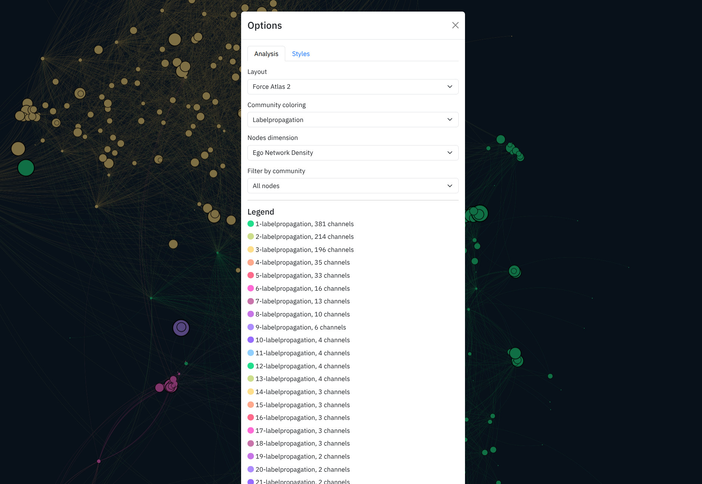
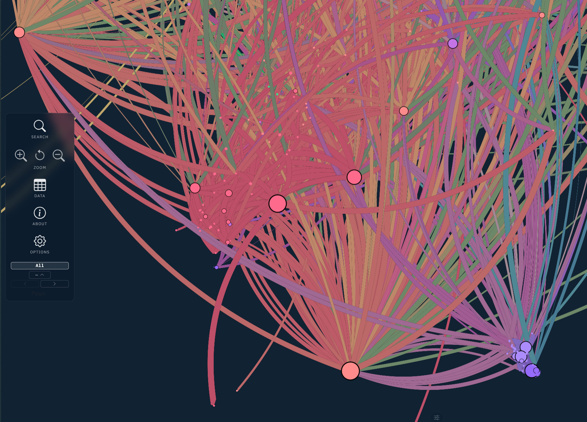
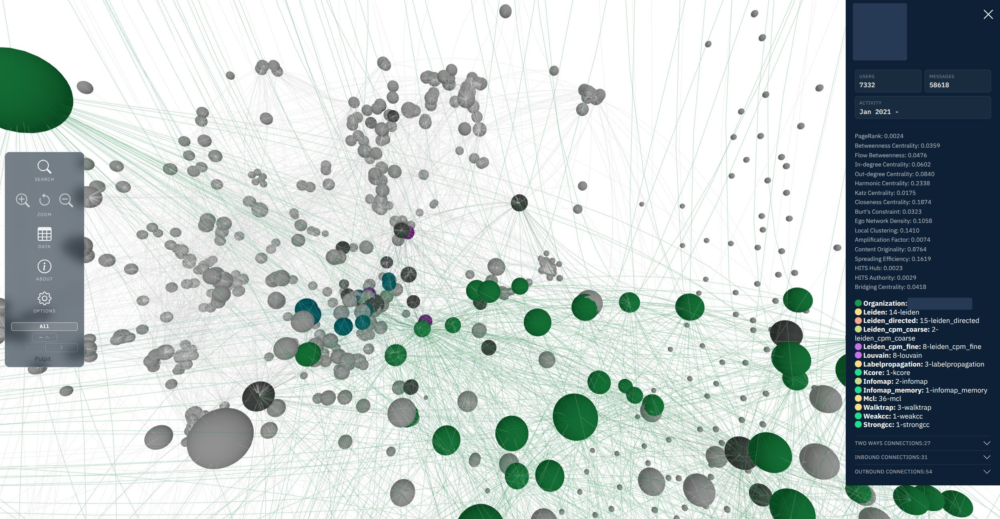
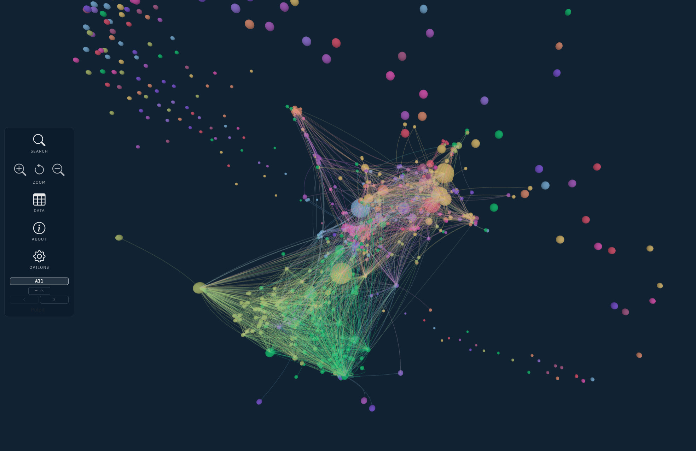

# Export formats

Every export is written by the **Structural Analysis** operation (or `structural_analysis` on the CLI) into a named subdirectory of `exports/`. This document describes each output file and how to use it.

---

## Directory structure

Every page and download is named after what it shows, and a page and its downloads share their name
(`dominance.html`, `dominance.xlsx`, `dominance_pairs.csv`). An export holds only the pages it has data for.

```
exports/
  <name>/
    index.html              ← landing page: the study, every page by research question, every file, how to cite
    methods.html            ← the methods record (PARAMETERS.md as a page)
    data.html               ← the data dictionary: every file and column (DATA.md as a page)
    graph.html              ← structural 2D map (with --graph-2d)
    graph3d.html            ← structural 3D map (with --graph-3d)
    coordination.html       ← 2D co-forwarding coordination map (with --coordination-2d)
    coordination3d.html     ← 3D co-forwarding coordination map (with --coordination-3d)
    channel_table.html      ← channels (with --html)
    channel_table.xlsx      ← … as a spreadsheet (with --xlsx)
    nodes.csv, edges.csv    ← channels and ties as CSV (with --csv)
    network_table.html / .xlsx      ← whole-network statistics
    network_label_flows.csv         ← label → label citation flows (HOMOPHILY group + --csv)
    community_table.html / .xlsx    ← community statistics
    consensus_matrix.html           ← agreement of the grouping methods (with --consensus-matrix)
    structural_equivalence.html     ← structural equivalence matrix (with --structural-similarity)
    behavioural_equivalence.html    ← behavioural equivalence matrix (with --behavioural-equivalence)
    dominance.html / .xlsx          ← dominance analysis (with --dominance)
    dominance_channels.csv, dominance_pairs.csv
    event_impact.html / .xlsx / .csv  ← event impact (with --event-impact)
    links.html / .xlsx              ← outbound links (with --links)
    links_channel_sites.csv, links_colinking.csv
    audience.html / .xlsx           ← the commenters (on unless --no-audience)
    audience_<section>.csv
    interesting_messages.html       ← posts ranked by structural reach (with --interest-structural)
    robustness_table.html / .xlsx   ← node-removal robustness (with --robustness)
    vacancy_analysis.html           ← replacement candidates of closed channels (with --vacancy-measures)
    network_compare_table.html      ← comparison of two analyses (compare_analysis)
    <page>_2.html, <table>_2.xlsx   ← the compared analysis' pages and workbooks (compare_analysis)
    network.gexf, network.graphml   ← the network for Gephi, igraph, NetworkX, Cytoscape (with --gexf / --graphml)
    dyads/                  ← data for network-modelling tools (with --dyadic-export; see docs/dyadic-models.md)
      README.md, actors.csv, edgelist.csv, events.csv, dyads.csv (with --mrqap), waves/
    PARAMETERS.md           ← every parameter behind the numbers (always)
    DATA.md                 ← the data dictionary as plain text (always)
    summary.json            ← name, counts and CLI options, machine-readable (always)
    robots.txt              ← crawler rules (always; see Publishing an export)
    .htaccess, _headers     ← no-index HTTP headers for Apache / Netlify / Cloudflare Pages (without --seo)
    sitemap.xml             ← the indexable pages (with --seo --public-url)
    css/, js/, favicon.ico, pulpit_logo.svg  ← what the pages share
    data/                   ← the JSON the pages read
      channels.json, channel_position.json, channel_position_3d.json, communities.json, meta.json,
      network_metrics.json, timeline.json (with --timeline-step), and each analysis' own file:
      structural_equivalence.json, behavioural_equivalence.json, robustness.json, dominance.json, mrqap.json,
      event_impact.json, links.json, audience.json, interesting_messages.json, vacancy_analysis.json
      near_copies.csv, image_copies.csv  ← copy audit lists (with --near-copy-edges / --image-copy-edges)
    data_<period>/          ← the same for one period of a timeline: data_2024/, data_2024Q1/, data_2024-03/
    data_2/                 ← the compared analysis' data and its summary.json (compare_analysis)
    data_coordination/      ← the coordination maps' data (data_coordination_<period>/ per period with ties)
    media/channels/<username or id>/profile/  ← channel pictures the maps show
```

### Atomic writes

All output first goes to a `<name>.tmp` staging directory. Only after every file — including `PARAMETERS.md` and `summary.json` — has been successfully written is the staging directory renamed to `<name>`. Aborting an in-progress export (via the Abort button or Ctrl-C) leaves any previous export with the same name untouched, and deletes the unfinished `<name>.tmp`; so does a run that fails. A stale `<name>.tmp` directory left by a run that was killed otherwise (from a terminal, or by the system) is removed automatically at the start of the next export with the same name, and **Manage → Maintenance → Temporary files** removes the others ([Web interface § Maintenance](web-interface.md#maintenance--managemaintenance)). An analysis holds `exports/<name>.lock` for as long as it runs, so Maintenance leaves its folders alone, and a second analysis of the same name stops at once instead of overwriting them.

---

### Opening the output files: HTTP server vs. direct file access

The landing page, the methods record and the data dictionary open straight from disk (`file://`). Every other page
reads its data with JavaScript (`fetch()`), which browsers block for pages opened from disk: serve the folder over
HTTP. The downloads (spreadsheets, CSV, GEXF, GraphML) open in any program.

**Quickest way to serve locally:**

```sh
cd exports/<name>
python -m http.server 8001
```

Open [http://localhost:8001](http://localhost:8001) in your browser. This works on macOS, Linux, and Windows — run it from any terminal with Python on the PATH.

If the Pulpit web interface is already running (`python manage.py runserver`), the export is also accessible at `http://localhost:8000/exports/<name>/index.html` without starting a separate server.

---

## Publishing an export

An export is a static web site: upload the folder to any web server and it works there. Before you upload it, choose whether search engines should find it. **Presentation → SEO-optimised** (`--seo`) decides this for every page and file in the export, and it is **off by default**.

### Private (default): kept out of search engines and AI crawlers

Without `--seo`, the export asks every crawler to stay away, and asks AI crawlers explicitly:

- **Every page** asks not to be indexed, followed, cached, quoted in snippets, translated or used for AI (`<meta name="robots" content="noindex, nofollow, noarchive, nosnippet, noimageindex, notranslate, noai, noimageai">`). It also carries `<meta name="tdm-reservation" content="1">`, the [TDMRep](https://www.w3.org/community/reports/tdmrep/CG-FINAL-tdmrep-20240510/) machine-readable reservation of text and data mining under Article 4 of EU Directive 2019/790. Pages send no referrer, so clicking a link out of the export does not tell the other site where the export lives.
- **`robots.txt`** refuses every crawler (`User-agent: *` / `Disallow: /`) and repeats the refusal for each AI crawler by name: OpenAI's, Anthropic's, Perplexity's, Common Crawl's, ByteDance's, Meta's, Google's and Apple's AI-training tokens, and more (the list is `AI_USER_AGENTS` / `AI_ROBOTS_TOKENS` in `network/publication.py`).
- **`.htaccess`** (Apache) and **`_headers`** (Netlify, Cloudflare Pages) send the same refusal as an `X-Robots-Tag` HTTP header on every file, including the JSON data, CSV, spreadsheets and channel pictures, which a meta tag cannot cover. On Apache, `.htaccess` also answers the AI crawlers with *403 Forbidden*, since several ignore `robots.txt`.

These are requests that reputable search engines and AI companies honour, not access control. Anyone who has the address can still open the export, and so can a crawler that ignores the rules. For material that must stay confidential, put the folder behind a password (HTTP authentication on the server) or do not upload it.

### Search-optimised (`--seo`): made to be found

With `--seo`, the export is built to rank and to show well when shared:

- Every page the landing page links to is indexable and has its own `<title>`, a `<meta name="description">`, and Open Graph and Twitter tags for link previews. A page the landing page does not link to (a page of your own dropped into the folder) stays `noindex`. An export holds only the pages it has data for: a map page is written only when its map was requested.
- The landing page describes the export as a schema.org [`Dataset`](https://developers.google.com/search/docs/appearance/structured-data/dataset), which Google Dataset Search reads. The description has the number of channels and ties and the date range, and its downloads are the export's CSV, XLSX, GEXF and GraphML files. The other pages have a breadcrumb back to the landing page.
- `robots.txt` lets every crawler in.

Set **Public URL** (`--public-url https://example.org/report/`) to the address the export will have once uploaded. Pages then get a canonical link and `og:url`, and `sitemap.xml` lists the indexable pages, with `robots.txt` pointing to it. Both need full addresses, so without a public URL neither is written, and the run warns you. The address is recorded in `summary.json`, and **Compare Analysis** reuses it.

### Where the files take effect

- `robots.txt` counts only at the root of a site (`https://example.org/robots.txt`). If the export goes into a subfolder, copy its rules into the site's own `robots.txt`, adding the folder to each path. With `--seo`, submit `sitemap.xml` in Google Search Console or Bing Webmaster Tools. The page tags work wherever the folder sits.
- `.htaccess` is read by Apache wherever `AllowOverride` permits it. If the server answers *500 Internal Server Error* after you upload the folder, the host does not allow these settings: delete `.htaccess`. `_headers` is read only at the root of a Netlify or Cloudflare Pages site. GitHub Pages reads neither file, and some upload tools skip files whose names start with a dot.
- When you replace an online export with one made under the other setting, delete the old folder first, so a stale `.htaccess` or `sitemap.xml` does not stay behind.
- Disallowing a page in `robots.txt` keeps crawlers from reading it. Search engines can still list its bare address, with no title or snippet, if another site links to it. The `noindex` tags and headers cover crawlers that do fetch the page.

---

## index.html — landing page

The entry point. It opens with the study: the analysis' title, the number of channels and ties, the period, what a
tie is and how it is weighted, the timeline, the date it was generated and the Pulpit version, with links to the
methods record, the data dictionary and *How to cite*. The pages follow in cards grouped by research question:
*Maps*, *Network structure*, *Channels*, *Change over time* (with the timeline's periods), *Content and audience*,
*Resilience and succession*, and *Comparison* when Compare Analysis has added the compared analysis' pages. Each
card opens its page, downloads its files and links its method document. *Data and methods* lists every file of the
export, by kind, with its format, size and what it holds; *How to cite* gives a citation of the analysis and one of
the software.

The landing page is written last, from the files actually on disk, so it never links a page or a file the export
does not hold.

### Navigation

Every page shares one top bar: the Pulpit logo and a breadcrumb lead back to the landing page, and the *Contents*
menu lists every page of the export, grouped as on the landing page, the current page marked. Each page opens with its
title, the question it answers and, on the right, its *Method* document and a *Download* menu of its own files. Long
pages list their sections under *On this page*; the method details sit in a *How to read this page* block. The maps
carry the same bar, floating over the canvas.

Method links point at the documentation of the version that produced the export (the release tag; `main` for a
development build), so they keep describing the method the numbers came from.

### Spreadsheets

Every workbook opens on an **About** sheet: the analysis and its scope, when and with what it was made, its method
document, then every sheet and every column with its meaning. Each other sheet holds one table, its header row frozen
and filtered, its columns sized and formatted: shares as percentages of the 0–1 fractions the cells hold, p- and
q-values with three decimals (`< 0.001` below that), counts with thousands separators; every cell keeps its exact
value, and a yes/no column holds `1` / `0`. A table given for every period of a timeline opens with a **Period** column
("All periods" for the whole range, then each period's key), so every period sits in the same table and a filter on
that column shows one; a table without that column covers the whole range only. A table too long for one sheet (a
sheet holds 1,048,576 rows) continues in a sheet of the same name followed by `(2)`, `(3)`… A table with one row per
channel, or per pair of channels, carries the channels' ids (`Channel ID`), the same in every file of the export.

---

## graph.html — structural 2D map

<figure>

<figcaption><em>Options panel: switch community strategy, resize nodes by any computed measure.</em></figcaption>
</figure>
<br>

Powered by [Sigma.js](http://sigmajs.org/). Generated with `--graph-2d`. **Requires an HTTP server** — see [Opening the output files](#opening-the-output-files-http-server-vs-direct-file-access).

**Controls:**

- **Search** — type a channel name to highlight and zoom to it
- **Community filter** — colour nodes by any active community strategy; switch strategies via the options panel
- **Node size** — resize nodes by any computed measure (PageRank, amplification, etc.)
- **Click a node** — opens a detail panel with subscriber count, all computed measures, and direct links to the channel and to its detail page in the web interface
- **Period navigator** — appears when the export has a timeline; step through its periods (years, quarters or months) with animated transitions (see [Workflow § Timeline export](workflow.md#timeline-see-how-the-network-changed-over-time))

<figure>

<figcaption><em>Details of the structural 2D map (fully opaque edges, vaporwave palette).</em></figcaption>
</figure>
<br>

> **[PLACEHOLDER: `images/workflow-timeline-nav.gif`]** Period navigator: step through the timeline's periods with animated transitions.

---

## graph3d.html — structural 3D map

Powered by [Three.js](https://threejs.org/). Generated with `--graph-3d`. **Requires an HTTP server** — see [Opening the output files](#opening-the-output-files-http-server-vs-direct-file-access).

- Rotate, zoom, and pan the graph in three dimensions
- Click a node to open the same detail panel as in the 2D view
- The period navigator is also present when the export has a timeline

<figure>

<figcaption><em>Node detail panel: subscriber count, all computed measures, direct channel link.</em></figcaption>
</figure>
<br>
<figure>

<figcaption><em>Structural 3D map (~800 nodes, ~5,000 edges): rotate, zoom, click nodes to inspect measures.</em></figcaption>
</figure>

---

## channel_table.html / .xlsx — per-channel metrics

One row per channel. All computed measures appear as sortable columns. Generated with `--html`; the Excel version with `--xlsx`.

Columns: the channel's id, name and Telegram address, its label in the primary label group, its environment depth, subscribers and messages, its in- and out-strength, every computed measure (PageRank, amplification factor, …), its community under each grouping method (`Community: <method>`), its label in each label group used as a partition (`Label: <group>`), and its first and last month of activity. On a timeline export the workbook's `Channels` sheet holds every period, one row per channel and period.

Click any column header to sort. Download the `.xlsx` for further analysis in a spreadsheet application.

---

## network_table.html / .xlsx — whole-network statistics

Whole-network metrics organized by group (SIZE, PATHS, COHESION, etc.), one row per metric. Includes an interactive scatter plot: drop any two measures on the axes to compare their distributions across channels. A modularity-by-strategy table shows partition quality for every active community detection algorithm. (The cross-strategy **Partition comparison** matrices are rendered on `community_table.html`; the workbook has them in its `Partition comparison` sheet, one row per index and pair of methods.) The workbook holds one table per sheet: `Statistics`, `Modularity`, `Partition comparison`, and the sheets of the options below.

- With the `SIGNIFICANCE` group, the metrics table gains one **vs …** column per random-graph baseline (z and p); the `HOMOPHILY` rows fill the *vs label permutation* column. The workbook's `Statistics` sheet carries the same z / p columns.
- With the `HOMOPHILY` group, a **Homophily by label group** section follows: per partition label group the assortativity and E-I line, a per-label table (inbreeding homophily citing / cited with BH stars, net-exporter index, out-of-scope share) and the label → label **citation-flow heat map**. The workbook adds the `Homophily` (one row per label group), `Homophily by label` and long-format `Label flows` sheets, each with a `Period` column; with `--csv`, `network_label_flows.csv` is the `Label flows` table.
- With `--mrqap`, a **Dyadic regression (MRQAP)** section shows the two models' coefficients, standardised β, t and permutation p; the workbook adds the `MRQAP models` and `MRQAP coefficients` sheets. Raw payload: `data/mrqap.json` (and `data_<period>/mrqap.json`).

`network_metrics.json` carries all of it per period: `summary_rows` (each with its `significance`), `significance_columns`, `label_mixing` and `mrqap`.

For a full explanation of each metric, see [Whole-network statistics](whole-network-statistics.md).

---

## community_table.html / .xlsx — per-community metrics

One section per active community detection strategy. For each strategy: a table of per-community structural metrics (node count, internal/external edges, density, reciprocity, clustering, E-I index, path lengths), a modularity-contribution column, and a collapsible label × community distribution panel (when the channels hold more than one label of the primary group). The workbook's `Communities` sheet has one row per community of every method (and period), with its colour and its members.

A **Partition comparison** block (cross-strategy ARI / AMI / NMI / VI heat-maps, with a period selector) sits below the per-strategy tables — see [Whole-network statistics § Partition comparison matrices](whole-network-statistics.md#partition-comparison-matrices-ari-ami-nmi-vi).

When the export has a timeline of two or more periods (`--timeline-step`), the full-range view additionally renders, under each strategy, a **Community flow** alluvial diagram — one column per period, communities stacked as boxes, and ribbons tracking how channels move between communities from one period to the next (thickness ∝ channel count). It is built client-side from the per-period `data_<period>/communities.json` files; with overlapping sliding windows it says so, since consecutive columns then share most of their messages. See [Community detection § Community flow across years](community-detection.md#community-flow-across-years) for how to read it.

At the foot of the page is an interactive **Community intersection** Sankey: pick any two strategies and a period (or the whole range) to see, as flows, how many channels each pair of their communities shares — the two partitions' cross-tabulation rendered as a bipartite Sankey. See [Community detection § Community intersection (Sankey)](community-detection.md#community-intersection-sankey).

For a full explanation of the metrics, see [Whole-network statistics](whole-network-statistics.md) and [Community detection](community-detection.md).

---

## structural_equivalence.html — structural equivalence matrix

Generated with `--structural-similarity` (the option keeps its earlier name; the page and its data file are named after what they show, structural equivalence).

A lower-triangle SVG heatmap where each cell (i, j) shows the **structural equivalence** (Lorrain & White 1971) of channels i and j: the cosine similarity of their weighted *tie profiles* — each channel's weighted out-citations to, and in-citations from, every other channel (`P = [A | Aᵀ]`, self-ties dropped), compared over third channels (the tie between the two channels compared is left out). Two channels score high when they cite, and are cited by, the same channels.

Color scale: white (similarity = 0, no shared neighbours) → steel-blue (similarity = 1, identical neighbourhood). Diagonal is always 1 and is marked in grey. Hover a cell for a tooltip: "Channel A × Channel B: 0.8742."

A sort dropdown above the matrix controls channel ordering:
- **Community** (default): groups channels by their plurality community assignment, making block-diagonal structure visible when communities are structurally cohesive.
- **Any measure** (e.g. PageRank): sorts channels descending by that value.

Pre-computed data is stored in `data/structural_equivalence.json` (lower-triangle float matrix + node labels and measure list). The page loads `channels.json` and `communities.json` at runtime for sorting.

See [Whole-network statistics § Structural equivalence matrix](whole-network-statistics.md#structural-equivalence-matrix) for interpretation guidance.

---

## behavioural_equivalence.html — behavioural equivalence matrix

Generated with `--behavioural-equivalence`.

A lower-triangle SVG heatmap where each cell (i, j) shows the Gower similarity (1 − mean absolute difference) of channels i and j's **behavioural-measure profiles**: amplification factor, content originality, diffusion lag, and audience/activity volume (followers, message count, log-scaled) — whichever were computed. Measures are min-max normalised per column; missing values (e.g. diffusion lag for a channel with no dated forwards) are imputed to the column median rather than 0. Two channels score high when they behave alike, independent of their network position.

Color scale, sort controls, and rendering match the structural equivalence matrix. Pre-computed data is stored in `data/behavioural_equivalence.json`.

See [Whole-network statistics § Behavioural equivalence matrix](whole-network-statistics.md#behavioural-equivalence-matrix) for interpretation guidance.

---

## consensus_matrix.html — cross-strategy agreement

Generated with `--consensus-matrix` (requires at least two non-metadata (non-LABELGROUP) community strategies).

A lower-triangle balloon plot where each cell shows how many active strategies co-assign a pair of channels to the same community. Larger, redder circles indicate higher agreement. Channels are sorted by plurality community assignment so that consistently co-clustered pairs appear near the diagonal.

Hover a cell for a tooltip: "Channel A × Channel B: N/K partitions agree."

See [Community detection § Consensus matrix](community-detection.md#consensus-matrix) for interpretation guidance.

---

## vacancy_analysis.html — vacancy succession analysis

Generated when at least one `--vacancy-measures` algorithm is selected and at least one vacancy is defined in the database. **Requires an HTTP server** — see [Opening the output files](#opening-the-output-files-http-server-vs-direct-file-access).

Loads `data/vacancy_analysis.json` at runtime and renders an accordion: one panel per vacancy channel, each listing scored replacement candidates with sortable columns for every selected measure.

See [Vacancy analysis](vacancy-analysis.md) for a full description of the algorithms and how to interpret the scores.

---

## robustness_table.html / .xlsx — node-removal robustness

Generated when `--robustness` is enabled, with the HTML produced when `--html` is also set and the XLSX when `--xlsx` is set. **The HTML requires an HTTP server** — it loads `data/robustness.json` at runtime.

The HTML page contains a sortable summary table (one row per strategy and measure with R, the random networks' mean and SD, z, p, q and the critical share), one chart per measure overlaying every attack strategy's residual-size curve on its random-network band, the efficiency chart, and the scenario tables. The workbook has the same data, one table per sheet (`Summary`, `Curves`, `Efficiency`, `Ban waves`, `Modular`, `Ban replay`, `Alpha sensitivity`); see [Robustness analysis](robustness-analysis.md).

`data/robustness.json` carries the full payload (config, graph metadata, per-strategy curves and R/f_c values, optional null-model statistics, optional modular curves). `None` is used for undefined ratios so the file is plain JSON (no `Infinity` / `NaN`).

See [Robustness analysis](robustness-analysis.md) for what each metric measures, how to interpret the z-score, and the limits of the null model.

---

## dominance.html / .xlsx / .csv — dominance analysis

Generated when `--dominance` is enabled: `data/dominance.json` always, the HTML page with `--html`, the workbook with `--xlsx`, the two CSVs with `--csv`. **The HTML requires an HTTP server** — it loads `data/dominance.json` (and `timeline.json` for the period navigator) at runtime.

The page opens with the whole-network hierarchy tests (SpringRank energy, triangle transitivity and rank consistency, each against orientation-shuffled nulls), then a **Channels** table — one row per ranked channel with its role (dominant / dependent / broker / allied / peripheral), David's score and rank, SpringRank, satellites, supplies, its own largest dependence and reach concentration — and a **Pairs** table oriented dependent → dominant with each side's content and reach dependence, the validation of each link and the net balance. The workbook has `Channels`, `Pairs` and `Hierarchy` sheets (each with a `Period` column on a timeline export); the two CSVs carry the `Channels` and `Pairs` tables of the full range, with the same columns in snake_case. With `--dominance` on, the channel table and map also gain a **David's score** column. With a timeline each `data_<period>/` carries its own `dominance.json`.

See [Dominance analysis](dominance.md) for the method, the null model and how to read the roles.

---

## coordination.html / coordination3d.html — co-forwarding coordination maps

Generated per toggle — `coordination.html` with `--coordination-2d`, `coordination3d.html` with `--coordination-3d` — when at least one channel pair survives the thresholds. **Both require an HTTP server** — they are the standard 2D/3D graph viewers re-pointed at `data_coordination/` (`channels.json`, `channel_position.json`, `channel_position_3d.json`, `communities.json`), which holds the coordination network: channels tied when they repeatedly forwarded the same origin message within `--coordination-window` seconds, with edge weight equal to the number of distinct co-forwarded origins and the coordination node measures (`coordination_strength`, `coordination_partners`, `coordination_ratio`) driving the *Nodes dimension* selector. Only channels with at least one retained tie appear. Node colours and community assignments match the main maps, so the two layers read side by side.

With a timeline (`--timeline-step`), each period with surviving ties additionally gets a `data_coordination_<period>/` directory (same four files), and `data_coordination/timeline.json` lists those periods — the coordination pages then show the same period navigator as the main maps, with per-period layouts seeded from the full-range coordination layout for a stable orientation.

See [Coordination analysis](coordination-analysis.md) for the method and interpretation guardrails.

---

## network_compare_table.html — network comparison

Generated by Compare Analysis. Requires a previous `structural_analysis` export as the reference. Both exports must be sites of this layout (every page carrying the shared navigation): Compare Analysis stops with a message on an export made by an earlier version of Pulpit — run its structural analysis again, then compare. The compared analysis' pages and workbooks are copied into the export as `<name>_2.html` / `<name>_2.xlsx` and its data as `data_2/` (with its own `summary.json`); the landing page lists them under *Comparison*, and each of those workbooks' About sheet states the compared analysis' own scope.

Contains:
- A three-column whole-network metrics table (current network, compare network, difference)
- A modularity-by-strategy comparison table
- Interactive scatter plots with the current network's channels in blue and the compare network's channels in red
- A "Normalise axes [0–1] per network" toggle that min-max-scales each network independently, making size-dependent measures comparable across networks of different sizes

See [Workflow § Network comparison](workflow.md#compare-two-networks) for how to generate it.

---

## nodes.csv / edges.csv — CSV node and edge lists

Generated with `--csv`. Two plain-text CSV files, the most portable format for downstream analysis in R, Python, pandas, or shell scripts.

### nodes.csv

One row per channel: the channel table, the same columns as `channel_table.xlsx` in snake_case. Every CSV of an
export follows the same conventions: UTF-8, snake_case headers (the letters and digits of any script are kept, so a
label group named in Greek or Cyrillic keeps its name), an empty cell for a value that does not exist, booleans
as `0` / `1`, shares as fractions from 0 to 1, dates in ISO 8601. Text that a spreadsheet would run as a formula — a channel title beginning with `=`, `+`, `-` or `@` — is written behind an apostrophe (`'=…`), so opening a file in Excel or LibreOffice never executes it; strip that leading apostrophe when reading such a column with other software (channel ids are the keys to join on, never titles).

| Column | Content |
| :----- | :------ |
| `channel_id` | Pulpit's id of the channel: the id every file of the export uses (`edges.csv`, `dyads/`, the dominance and link CSVs) |
| `channel` | Channel name |
| `url` | Telegram URL |
| `label` | The channel's label in the primary label group |
| `environment_depth` | 0 for an observed channel, k for a channel of the environment reached at citation distance k |
| `subscribers` | Subscriber count |
| `messages` | Message count |
| `in_strength`, `out_strength` | Weighted in- and out-degree: the strength of the ties received and sent |
| *measure columns* | One per computed measure (`pagerank`, `amplification_factor`, …): only the measures the run computed |
| `community_<method>` | The channel's community under each grouping method, as a number (`community_leiden_directed`) |
| `label_<group>` | The channel's label in each label group used as a partition (`label_nation`) |
| `activity_start`, `activity_end` | First and last month with a message (`YYYY-MM`) |

Rows are sorted by in-strength, most cited first, as in the HTML and spreadsheet channel tables. The
[data dictionary](#datamd--datahtml--the-data-dictionary) of each export lists its columns with their meaning.

### edges.csv

One row per directed tie, from the citing channel to the cited one:

| Column | Content |
| :----- | :------ |
| `source_id`, `source` | The citing channel: its id (`channel_id` in `nodes.csv`) and name |
| `target_id`, `target` | The cited channel |
| `weight` | Tie weight computed by the active `--edge-weight-strategy` |
| `weight_forwards` | Raw count of message forwards contributing to this tie (before normalisation) |
| `weight_mentions` | Raw count of mentions (`t.me/` links and @handles) contributing to this tie (before normalisation) |
| `weight_copies` | Raw count of near-copies contributing to this tie — posts of the source channel whose text re-posted an earlier post of the target channel without the forward header; always `0` unless `--near-copy-edges` was on (see [Configuration § Near-copies as edges](configuration.md#near-copies-as-edges)) |
| `weight_image_copies` | Raw count of image copies contributing to this tie — picture posts of the source channel re-posting an image of an earlier post of the target channel without the forward header; always `0` unless `--image-copy-edges` was on (see [Image copies](image-copies.md)) |

`weight_forwards + weight_mentions + weight_copies + weight_image_copies` equals the raw total from which `weight` is computed (with the exception of the `NONE` strategy, where `weight` is always 1.0 regardless of counts). This lets you re-apply any normalisation or filter to only forwards vs. only mentions vs. only copies — in particular to drop the *inferred* copy citations and keep Telegram's own forward provenance.

**Quick start in Python:**

```python
import pandas as pd

nodes = pd.read_csv("exports/my-export/nodes.csv")
edges = pd.read_csv("exports/my-export/edges.csv")

# Top 10 channels by PageRank
print(nodes.nlargest(10, "pagerank")[["channel", "pagerank", "subscribers"]])

# Ties where forwards outweigh mentions
forward_heavy = edges[edges["weight_forwards"] > edges["weight_mentions"]]
```

**Quick start in R:**

```r
nodes <- read.csv("exports/my-export/nodes.csv")
edges <- read.csv("exports/my-export/edges.csv")

library(igraph)
g <- graph_from_data_frame(edges[, c("source_id", "target_id", "weight")],
                           directed = TRUE, vertices = nodes)
```

### data/near_copies.csv

Written whenever **Include near-copies as edges** (`--near-copy-edges`) is on, whatever the other outputs — it is the audit trail of the copy citations the graph was built with. One row per detected copy → origin link; on a timeline export each `data_<period>/` carries the period's own list.

| Column | Content |
| :----- | :------ |
| `copy_channel`, `copy_channel_id`, `copy_message_id`, `copy_date` | The later post (the one read as a forward) and its channel |
| `origin_channel`, `origin_channel_id`, `origin_message_id`, `origin_date` | The earliest in-scope post with near-identical text and its channel — the edge target |
| `lag_hours` | `copy_date − origin_date` in hours (what Diffusion lag receives) |
| `similarity` | Jaccard resemblance of the two posts' word-shingle sets (≥ the threshold by construction) |
| `copy_tokens`, `origin_tokens` | Normalised word counts of the two posts |
| `cluster_size` | Number of in-scope posts near-identical to this one, transitively — a text shared by ten channels is more likely a common quotation or meme than a copy of one specific post |
| `self_copy` | `1` when the origin is the copier's own earlier post (an archive re-post; it enters the graph only with *Include self-references*), else `0` |

A match proves the same text appeared earlier in another in-scope channel, not who copied whom; read this file before interpreting a copy edge.

### data/image_copies.csv

Written whenever **Include image copies as edges** (`--image-copy-edges`) is on; per timeline period too. One row per copy → origin **post** (an album is one post, identified by its first message):

| Column | Content |
| :----- | :------ |
| `copy_channel`, `copy_channel_id`, `copy_message_id`, `copy_date` | The later picture post and its channel |
| `origin_channel`, `origin_channel_id`, `origin_message_id`, `origin_date` | The earliest in-scope post showing the same image — the edge target |
| `lag_hours` | `copy_date − origin_date` in hours |
| `distance` | pHash Hamming distance of the matched images (0 = the same Telegram photo or an identical hash) |
| `cluster_size` | Posts in scope showing the image, transitively — a picture shown by many posts is more likely a common meme |
| `self_copy` | `1` when the origin is the copier's own earlier post |

See [Image copies](image-copies.md) for the guardrails.

---

## data/timeline.json — the timeline's periods

Written with `--timeline-step`. `{"step", "window_months", "overlapping", "periods": [...], "events": [...]}`:

- `step` — `year`, `quarter` or `month`; `window_months` — the sliding-window length (`null` = tumbling); `overlapping` — whether consecutive periods share days.
- `periods` — one entry per exported period, in time order: `key` (its `data_<key>/` directory: `2024`, `2024Q1`, `2024-03`; a sliding window takes the key of the step it ends with), `label` (`2024 Q1`, `Mar 2024`, `Apr 2023 – Mar 2024`), inclusive `start` / `end`, node and edge counts, the `has_*` flags the viewers filter on, and the period's `community_resolutions` / `community_fits`.
- `events` — the events recorded in Manage → Events inside the timeline: `date`, `subject`, `type`, `color`, `labels` (scope) and the `period_key` of the step containing the date (the navigators mark that period).

`data_coordination/timeline.json` has the same shape, listing only the periods with coordination ties. Exports before 0.29 wrote `{"years": [{"year", …}]}`; the viewers still read that form.

## event_impact.html / event_impact.xlsx / .csv — event impact

Written with `--event-impact` (`data/event_impact.json` always; the page with `--html`). For every event recorded inside the data: the weekly series of each metric around it, the fitted segments and the counterfactual continuation of the pre-event trend, and an effects table — level change (and its % for count metrics), slope change, HAC p, placebo p and BH q, plus notes (window cut by the data edge, few placebo dates, other events inside the window). A network-wide chart shows any metric's whole weekly series with the events marked. The XLSX has an `Effects` sheet (one row per event × metric, the CSV's layout) and a `Weekly series` sheet. See [Event impact](event-impact.md).

## links.html / links.xlsx / links_channel_sites.csv — outbound links

Written with `--links` (`data/links.json` always, per timeline period too; the page with `--html`). The categories' share of link events, a label × category matrix per partition label group, one row per observed channel (linking posts share, distinct sites, platform diversity, monetisation / mainstream / alternative shares, categorised share, top sites), one row per site (category, messages, channels, first and last link, the labels linking most) and the co-linking pairs (shared sites against the number expected by chance, BH q, the shared sites rarest first). The per-channel measures also join the channel table, `nodes.csv` and GEXF/GraphML. The XLSX has `Channels` / `Sites` (with a `Period` column on a timeline export), `Categories`, `Co-linking`, `Channel sites` and `Matrix <group>` sheets; `links_channel_sites.csv` is the long channel × site table with message counts, `links_colinking.csv` the pairs. See [Outbound links](outbound-links.md).

## audience.html / audience.xlsx / audience_*.csv — the commenters

Written unless `--no-audience`, when the scope holds at least one reply (`data/audience.json` always; the page with `--html`). The five sections of the web app's [Audience](audience.md) page, computed on the export's own scope: the observed in-target channels of the graph (so `--channel-types`, `--filter-labels` and the lost / private switches apply; dead leaves and environment channels are left out) and their posts inside their in-target periods and `--startdate` / `--enddate`. With `--timeline-step` each period is computed again on its own graph and days (`data_<period>/audience.json`, `has_audience` in `timeline.json`, a period navigator on the page; periods without comments are left out). The page shows each section's figures, charts and tables; the XLSX has a `Summary` sheet, the five main tables (`Participation`, `Breadth labels`, `Overlap pairs`, `Retention by month`, `Channel commenters` — the CSVs' columns with readable names, numbers kept numeric; on a timeline export `Summary`, `Participation` and `Overlap pairs` carry a `Period` column) and the tables beside them (`Activity`, `Breadth classes`, `Overlap channels`, `Overlap labels`, `Cohorts`); the CSVs cover the full range only; `audience_participation.csv`, `audience_breadth.csv`, `audience_overlap.csv`, `audience_retention.csv` and `audience_channel_commenters.csv` are the page's CSVs. Aggregates only — no commenting account is identified; channels are named, as on the page.

## network.gexf / network.graphml — network exchange formats

Generated with `--gexf` and `--graphml`. Import directly into [Gephi](https://gephi.org/), [Cytoscape](https://cytoscape.org/), or any other network analysis application that reads GEXF or GraphML.

Both files include all node attributes (channel name, its primary-group label as `organization`, subscriber count, environment depth — `0` in target, `k` for an environment channel *k* citation hops out, `1` for a dead leaf — all computed measures, community assignments for each active strategy) and edge weights.

---

## PARAMETERS.md — the parameters of the run

`PARAMETERS.md`, at the root of every export, is the reproducibility record of the run: everything that shaped its numbers, in one readable document — paste it into a methods appendix, or diff two of them to see why two exports differ. It is written at the end of the run, just before `summary.json` and inside the staging directory, so it is published atomically with the export it describes (one file per export; the per-year exports of a timeline run share it).

- **Header** — export name, generation time, Pulpit version, and the size of the full-range graph.
- **Run options** — what was chosen for this run (CLI flags, the Operations panel, or the configuration fallbacks), *as resolved*: defaults filled in and automatic values replaced by the value actually used — the CPM resolution γ of a bare `LEIDEN_CPM` (the network density), the basis a `MODULEROLE` resolved to, the ForceAtlas2 iteration count an `Nx` value became, the vacancy candidate cap, the structural-interest basis. Grouped by topic (scope & data window, edges & weights, near-copies, measures — one row per measure token —, communities — one row per strategy instance, plus a per-year γ table for the CPM-family strategies on a timeline run —, network statistics, layout, robustness, coordination, dominance, vacancy, structural interest, timeline). Each row gives the value, the CLI flag and what the option controls; the features the run did not compute are listed in one closing line.
- **Fixed parameters** — the values set in Pulpit's code (seeds, iteration counts, thresholds, and the library defaults the code relies on, which it passes explicitly), one table per section, listed only for the parts of the analysis that ran. Each row names the parameter, its value, what it affects, and where it is set (`module.py: CONSTANT`). Every analysis module declares these next to the constants it uses (a `FIXED_PARAMETERS` tuple, `network/parameters.py`), so the document is read from the very values the computation used.
- **Software** — Python and the versions of the libraries that compute results (networkx, python-igraph, leidenalg, graph-tool, numpy, scipy, scikit-learn, umap-learn, fa2, Django); a library that is absent reads *not installed*.

`summary.json` carries the same run options in machine-readable form (it is what **Import from export** reads); `PARAMETERS.md` is the human-readable counterpart that also records the fixed parameters and the software.

## DATA.md / data.html — the data dictionary

Every export describes its own files. `data.html` (a page of the export, in its navigation) and `DATA.md` (the same as
plain text) list every downloadable file by kind (methods and records, spreadsheets, CSV tables, network files,
folders) with what it holds, then every column of every CSV and every sheet of every workbook with its meaning. The
tables kept inside folders are listed too: the copy audit lists `data/near_copies.csv` and `data/image_copies.csv`, and
the files of the `dyads/` bundle. The folders and files written once per timeline period make one row each
(`data_<period>/`, `data_coordination_<period>/`, `dyads/waves/wave_<period>.csv`), which says how many there are.

The columns are read from the files themselves, so the dictionary always matches them. The meanings come from
`network/data_dictionary.py`. A column is described in the table it stands in: *Ratio* is observed over expected ties in
the label flows, and surviving ties inside over between communities in the modular robustness table. A column the
table does not single out takes its general meaning, keyed by its snake_case form, so a spreadsheet header
(`In-strength`) and its CSV counterpart (`in_strength`) share one entry. The workbooks' About sheets read the same
meanings. A file that cannot be read is listed with a note instead of its columns.

## methods.html — the methods record as a page

`PARAMETERS.md` (above) rendered as a page of the export, in its navigation and linked from the landing page's study
header: the run options, the fixed parameters and the software versions, the plain-text file one click away.

## summary.json / meta.json — machine-readable metadata

`summary.json` records the name, creation timestamp, Pulpit version, node and edge counts, `first_message` / `last_message` (the first and last local day of the analysed messages: the period the landing page states when no `--startdate` / `--enddate` bounds the run), `near_copies` / `image_copies` (the number of copy → origin links the graph was built with, `null` when that option was off), and every CLI option used to generate this export. Useful for reproducing an export or documenting methodology. It also records `community_resolutions`: the CPM resolution γ each `LEIDEN_CPM` partition of the full-range graph was computed with (its explicit value, or the network density for a bare token), and for each `LEIDEN_TEMPORAL` partition a `{"<year>": γ}` object over its year slices — `{}` when neither strategy ran. On a timeline export each period's entry in `data/timeline.json` carries the same `community_resolutions` object for that period's partitions (present only when a CPM-family strategy ran). See [Leiden CPM](community-detection.md#leiden-cpm). `community_fits` records, per partition key, how each stochastic strategy was fitted: `objective`, `runs` (seeded fits), `best` and `worst` objective value, `stability` (mean Adjusted Rand Index of the other fits to the reported partition) and `identical_share` (share of fits that found exactly it); a `LEIDEN_TEMPORAL` entry adds `interslice_weight`, the absolute identity-link weight its relative ω resolved to. Each period entry of `data/timeline.json` carries its own `community_fits`. See [Best of many fits](community-detection.md#best-of-many-fits-and-how-stable-the-answer-is).

`meta.json` records export date, project title, edge direction description, edge weight strategy, date range, total node/edge counts, and configuration flags.

---

← [README](../README.md) · [Getting started](getting-started.md) · [Workflow](workflow.md) · [Measures](network-measures.md) · [Communities](community-detection.md) · [Network stats](whole-network-statistics.md) · [Layouts](graph-layouts.md) · [Vacancy analysis](vacancy-analysis.md) · [Robustness](robustness-analysis.md) · [Coordination](coordination-analysis.md) · [Interesting messages](interesting-messages.md) · [Web interface](web-interface.md) · [Exports](export-formats.md)


