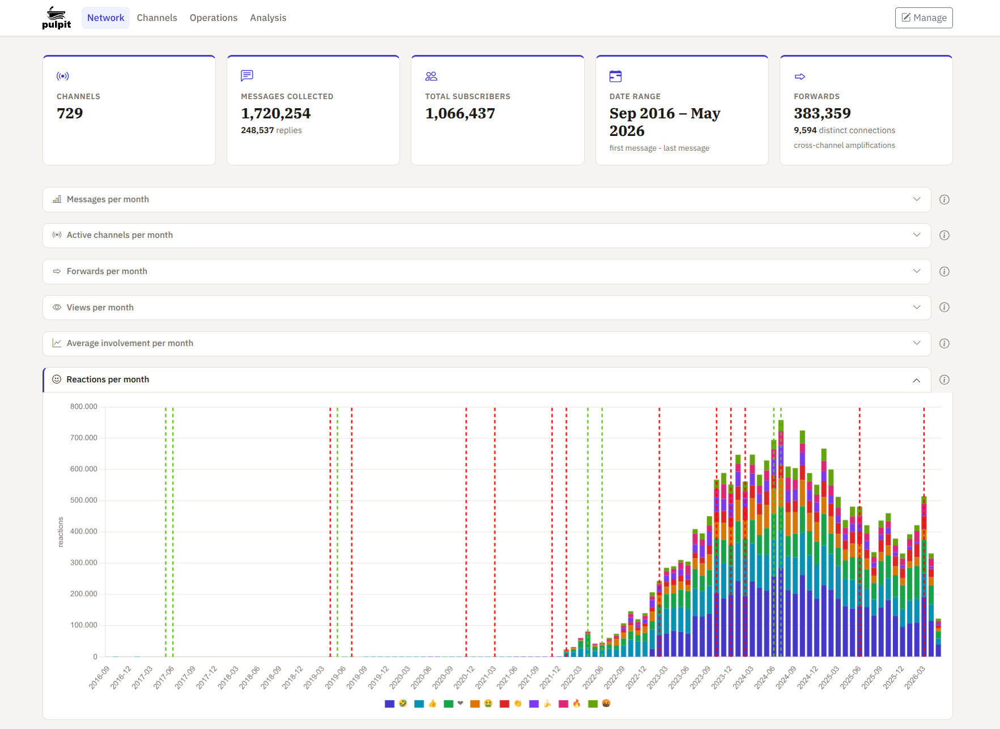
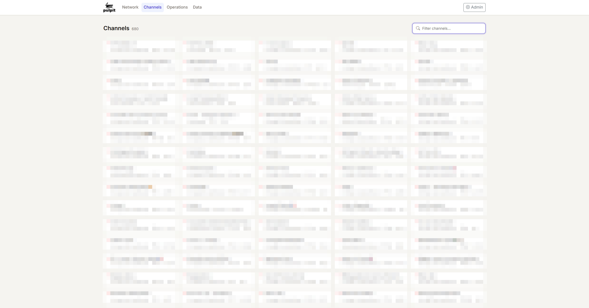
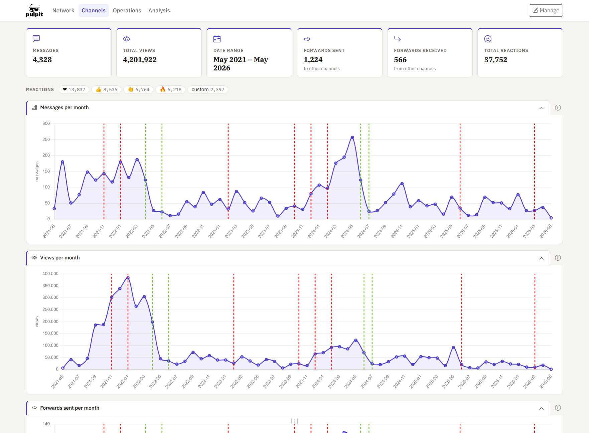
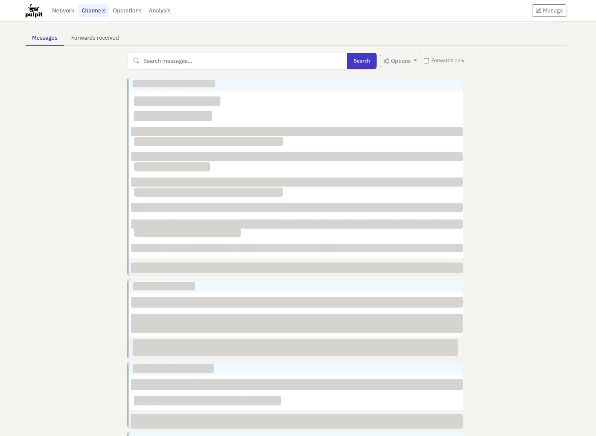
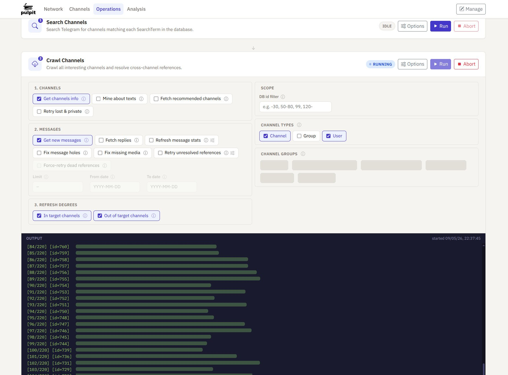
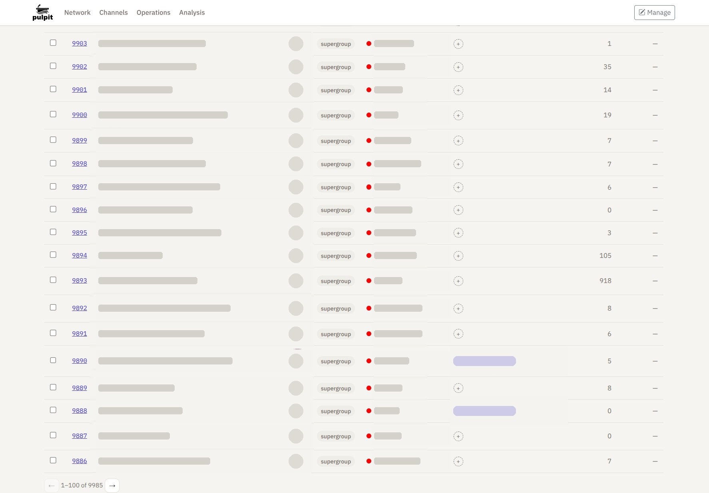

# Web interface

Pulpit's browser interface is the primary way to browse collected data, monitor operations, and manage the corpus. This document describes each section of the interface.

The Operations panel is the dashboard you use to launch data collection and analysis. Click Run, watch the log stream in real time, then open the Data tab when done to see the outputs.

---

## Home page — `/`

<figure>

<figcaption><em>Home page: project-level summary cards, time-series charts, with open Reactions chart.</em></figcaption>
</figure>
 

The landing page gives a project-level snapshot of the monitored corpus:

- **Scope selector** — a dropdown of labels, those of **container** groups first (e.g. the continents of a "Continents" container; see [Labels](#labels--managelabels)), then every label an in-target channel holds, by group (e.g. *Nation: Germany*, *Type: Local group*). Selecting one recomputes everything below over just its channels — for a container label, the channels whose labels sit under it (Europe's nations): the summary cards, every time-series chart, and the message feed. A channel counts if it held the label at any time. "All channels" restores the full corpus; the selection travels with search and pagination. The Audience page has the same menu.
- **Split by** — splits every summary card and chart by the labels of a partition group: each chart draws one line per label, and the split button at the top right of any card shows or hides, on all of them, the figures per label (*Continent*, *Nation*, *Type*…): the five labels with the most active channels, the others together as *Other*, and the channels holding no label of the group. The lines are the same on every chart, so a label keeps its colour and point shape. A label is read at each post's date, a container group's through its child labels; a channel itself, and its subscribers, count under its label today. The cards' columns add up to the card, except unique commenters: an account commenting under two labels counts in both. Views are shortened there (35.2M; hover for the figure). Totals (messages, active channels, forwards, views, reactions) add up over the lines, *Reactions* counting every reaction instead of the eight most used emoji; *Active channels* counts a channel twice in a month it changes label. The views-per-post and reaction-rate charts show the median channel, with a gap in months when fewer than five channels of the label were active; *own posts and forwards* becomes two charts side by side, each with its own scale. It combines with **Scope**: *Scope: Germany* split by *Type*.
- **Summary cards** — two rows of cards. Row 1: channels (with the to-inspect count), messages collected (with replies), media (with a per-type breakdown), and total views (with *subscriptions* — the sum of each channel's subscriber count, so someone following several channels counts once per channel; Telegram shows a broadcast channel's subscriber list only to its admins, so distinct subscribers cannot be counted — and *unique commenters*, the distinct user accounts replying in the channels' linked discussion groups, a floor on the distinct audience, without the Telegram bots and bulk posters [Manage → Commenters](#commenters--managecommenters) leaves out). Row 2: forwards sent, mentions sent, and the date range of the message archive. Lost messages are excluded from every aggregate so the totals match the crawl scope. The cards are built from several cached aggregates and memoised for fast page loads on large databases (scoped views bypass the cache and are computed live).
- **Time-series charts** — month-by-month aggregates across the whole corpus: messages sent, active channels, forwards, views, reactions, views per post (mean and median), views per post of own posts and forwards, and reactions per 1,000 views. *Views per post: mean and median* draws it twice: the **mean of all posts**, where channels that post a lot weigh more, and the **median of active channels**, where each channel that posted that month counts once through its own mean. When the two part, the mean is being carried by a few large or busy channels. *Own posts and forwards* splits the median channel's views per post by kind, since forwards usually get far fewer. *Reactions per 1,000 views* is closer to involvement than views are: own posts only, an album counted once (its reactions sit on one message, its views on all), from 2022, when Telegram added reactions. Its latest months read high and those of the views charts read low, because reactions come faster than views and posts keep gaining views for months. Each chart is rendered by the same Chart.js component used on channel detail pages, including the dashed vertical-line event annotations (see [Workflow § Events](workflow.md#mark-events-on-charts)).
- **Recent messages** — a feed of the latest posts collected, with a link to each source channel and the same post-card layout used elsewhere (views, forwards, reactions, edit indicator, replies pill).

---

## Channel list — `/channels/`

<figure>

<figcaption><em>Channel list: the channel cards, with the filter box.</em></figcaption>
</figure>
 

A paginated list of all channels in the database. Filters and controls:

- **Search** — filter by channel name or username
- **Label filter** — show only channels with a specific (primary-group, in-target) label
- **Sort** — by name, tag name, first activity, last activity, followers (subscriber count), message count, or label
- **Channel chips** — each card shows the channel's current label colour, subscriber count, message count, and group chips

A channel shows its network position data once crawled while it has an in-target **label period** — a time-bounded `ChannelLabel` whose `Label` has `is_in_target` set (see the channel editor below).

---

## Channel detail — `/channel/<id>/`

<figure>

<figcaption><em>Channel detail page: summary cards, reactions, and the messages and views charts with event lines.</em></figcaption>
</figure>
 

Each channel has a dedicated detail page with:

- **Message volume chart** — message activity over time, with event annotations (vertical lines for any configured events whose date falls within the chart period)
- **Views and reaction charts** — the home page's *Views per post: mean and median*, *own posts and forwards* and *Reactions per 1,000 views*, for this channel alone: the median is the channel's median post instead of the median channel, and own posts and forwards are the channel's mean of each kind
- **Network stats card** — in-degree, out-degree, all computed measures for this channel from the latest export
- **Vacancy Analysis card** — appears when the channel has a registered vacancy (see [Vacancy analysis](vacancy-analysis.md))
- **Message list** — paginated list of crawled messages with timestamps and forward indicators. Each post card shows views, forwards, reactions, and the post date. When a message has been edited after original publication, a pencil icon and "Edited" label appear in the footer (exact edit timestamp on hover). When a channel has "Sign messages" enabled, the post author's name appears on the card below the message body. Clicking a picture opens it full size on a dark overlay, fitted to the screen; click the picture for actual pixels, and step through the other pictures of the same post with the ‹ › arrows, the arrow keys or a swipe (Esc or a click outside closes it). The bar at the bottom shows the picture's pixel size — the largest size Telegram stores, which is Telegram's own recompressed copy for anything posted as a photo; the uploader's original file is kept only when it was sent as a file (stored as *other media*).
- **Forwards** — in a message list's *Options* menu (every list but the *Forwards received* tab, which holds forwards only), a tristate control (Include / Exclude / Only; default Include) for the messages shared from elsewhere: any message with a forward header, whether its source is a stored channel, a private one or a hidden account — what *Content originality* counts as forwarded. *Exclude* leaves a channel's own posts.
- **Unique** — in a message list's *Options* menu (every list: home, search, top messages, both channel-page tabs), shows each post once, hiding its shares: the original when the list holds it, otherwise its earliest share in the list — e.g. the first forward of a post from an out-of-target channel. A share is a forward, grouped with the others by the original post Telegram names in its forward header (shares of a post from a private channel included); it works on what the other options left, so with a date range the earliest share inside the range stands for a post published before it. A card that stands for several messages shows a ⧉ count of the copies in the list.
- **Replies** — in a message list's *Options* menu (every list), a tristate control (Include / Exclude / Only; default Include) for messages posted in answer to another one — the ones whose details show a *Reply to* line. Comments fetched from a channel's discussion group are not messages of the list and are not affected.
- **Comments** and **Reactions** — in the same *Options* menu (every list), Both / With / Without: keep only the messages that have comments in the channel's discussion group, or reactions, or only those that have none. Comments are Telegram's count, so they work whether or not the comments themselves were fetched; a message from a channel without a discussion group counts as having none. An album is judged as one post (Telegram puts its comments and reactions on its first message).
- **Source post** — a forward's details (the ⓘ button) name the original post with the date and time it was published there, and how long before this share.
- **Lost messages filter** — tristate control (Exclude / Include / Only; default Exclude). Lost messages are rows that Telegram no longer returns; they remain in the database but are excluded from every aggregate, edge weight, and citation measure. Switching to *Include* or *Only* renders them faded with a strikethrough body and a small "lost" chip in the footer.
- **Custom emoji** — a post's custom emoji are drawn in its text where Telegram draws them, and custom-emoji reactions get a pill each instead of one *custom* count (what is left of that count — paid reactions, emoji not downloaded yet — stays a *custom* pill). Animated (TGS) custom emoji and stickers are played with [lottie-web](https://github.com/airbnb/lottie-web), loaded from the CDN when a page shows one; webm ones are videos. They animate while on screen (reaction pills and pack previews only on hover) and stay still under the system's *reduce motion* setting. Hovering one names its pack. An emoji whose file isn't downloaded shows the plain emoji it stands for. Files come with **Sticker download** — see [Workflow § Custom emoji](workflow.md#custom-emoji).
- **Group emoji pack** — in the header of a boosted group that set a custom emoji pack as its own (every member can use it, Premium or not), linked to the pack's page. It is the one link between a pack and a chat that Telegram itself records; it is read with the channel details (*Get channels info*).
- **Custom emoji packs** — under the reactions, the packs the channel draws from in its own posts (forwards carry their source's emoji and are left out), with its most used emoji of each and how many times; in-target packs carry a ◎ mark, and each links to the pack's page.

<figure>

<figcaption><em>Channel detail page: the Messages and Forwards received tabs, with the search box and Options menu.</em></figcaption>
</figure>
 

---

## Vacancies list — `/channels/vacancies/`

Lists all channels registered as vacancies with:

- Last-known in-degree and out-degree
- Orphaned amplifier count (channels that forwarded this channel before its closure date)
- Closure date

See [Vacancy analysis](vacancy-analysis.md) for the full documentation.

---

## Emoji packs — `/channels/emoji-packs/`

The custom emoji in-target channels use, by pack and by emoji, linked from the channel list once any custom emoji is recorded. Which packs a channel picks is part of its visual identity — posting most custom emoji takes Telegram Premium — and two channels sharing an uncommon pack is worth a look.

Every figure is counted over the in-target channels' alive messages inside their in-target periods, like every figure on the site, and comes in the same columns: **channels** using the pack or emoji in their **own posts**, uses and posts in own posts, uses in **forwards**, custom-emoji **reactions** readers left with it, and the first and last day it was used. A forward carries its source's text, emoji included, so only own posts — messages with no forward header — say which emoji a channel picks itself. Emoji not resolved yet are counted under *Not resolved yet* until the next crawl looks them up.

- **Packs / Emoji tabs** — one row per pack (with its most used emoji and its `t.me/addemoji/…` link), or one row per emoji with its pack. A *group pack* badge marks a pack some group set as its own; hover it for the group's name. Both filter by the pack's classification: *All packs*, *In target*, *Not in target* (set in [Manage → Emoji](#emoji--manageemoji-packs); every pack starts out of target).
- **Pack page** (`/channels/emoji-packs/<id>/`) — the usage of each of its emoji, and of the pack per channel; for a group pack, the groups that set it as their own.
- **Emoji page** (`/channels/emoji-packs/emoji/<id>/`) — the emoji drawn large with its pack, the emoji it stands for, its format and whether it needs Premium; its usage; its **uses in own posts per month**, with event markers; the channels using it; and the **posts drawing it**, a message list with the usual search and *Options*.
- **CSVs** — *Channel × pack* (`/channels/emoji-packs/usage.csv`) and *Channel × emoji* (`/channels/emoji-packs/emoji/usage.csv`): one row per channel and pack or emoji, with the channel's ids, handle, title and label, the emoji's and pack's ids, names, `pack_in_target` and `pack_group_channel_ids` (the Telegram ids of the groups using it as their own pack, `;`-separated), and the usage columns above, for analysis elsewhere. Both follow the page's in-target filter. As in every CSV Pulpit writes, text that a spreadsheet would run as a formula (a title beginning with `=`, `+`, `-` or `@`) comes behind an apostrophe: strip it when reading that column with other software, and join on the ids.

---

## Audience — `/audience/`

The **commenters** of in-target channels — the accounts replying in their discussion groups, the one part of a channel's audience Telegram lets a crawler follow person by person. Replies count when they answer a post inside its channel's in-target period, without the Telegram bots and bulk posters [Manage → Commenters](#commenters--managecommenters) leaves out. The header says how many channels in scope have comments, and the **Scope** menu limits the page to a container label, as on the home page. Five tabs, each with a CSV of its main table:

- **Participation** — how concentrated the commenting is: top 10% / 1% shares, Gini coefficient, effective commenters, one-time and hyperactive accounts, a Lorenz curve, and the same per channel.
- **Breadth** (`/audience/breadth/`) — channels reached per commenter against chance, and the spread across the labels of each partition group.
- **Audience overlap** (`/audience/overlap/`) — the channel × channel matrix of shared commenters, tested pair by pair; exclusive commenters; label pairs; and whether shared commenters follow citations.
- **Retention** (`/audience/retention/`) — active and first-time commenters per month, and quarterly cohorts' return rates.
- **Channels as commenters** (`/audience/channel-commenters/`) — channels commenting under their own name on other channels' posts, a tie the citation graph does not see.

The pages show aggregates only — no account is named. Definitions, tests and references: [Audience](audience.md).

## Message tags

Tags are informal, colour-coded bookmarks for posts, kept so you can find them again. They are separate from [labels](#labels--managelabels): a tag has no group, no period and no in-target meaning, and it never affects crawls or exports.

- **Tagging** — the tag button in a post card's footer opens a small editor. Its tag field opens a list of the existing tags, with their colours and message counts (those already on the post are left out). Pick one, or type to filter the list: a name that matches an existing tag, ignoring case, reuses it, and any other name creates a new tag with the next free palette colour (the list offers *Create tag “…”*, and the button reads **Create & add**). Add an optional note, then **Add**. With the keyboard, ↑/↓ move through the list, Enter picks the highlighted tag and a second Enter adds it, and Esc closes the list. Each tag on the message has its own editable note and a remove button. The set of tags is shared by the whole team, and each tagging records who added it and when.
- **A tag goes on the whole post** — tagging a message also tags every share of it, and tagging a share also tags its original and every other share. A share is a forward: Telegram's forward header names the first publication even when a share is re-shared, so all shares lead back to the same original, which doesn't need to be crawled itself. Shares of a post from a private channel the crawler couldn't resolve are linked too. A forward that carries no original post id is a post of its own. A share fetched after the tagging takes the tag as soon as the crawler stores it, and so does the original of a tagged share if it is fetched later. The note belongs to the post, and removing the tag from any of its messages removes it from all of them. The editor says how many messages a tag reached, and adding a tag the post already carries through its original or a share is refused.
- **Sub-tags** — tags can nest, to any depth, so a broad tag can say which kind it is: *Hand gestures › Nazi salute*, *Hand gestures › OK sign*. A tag with no sub-tags is a plain tag, so single-level tagging works as before. A sub-tag implies its parent: filtering by *Hand gestures* also finds the posts tagged with any gesture under it. A post can carry several sub-tags of one tag (a post showing two gestures), but never a tag together with one of its own sub-tags, so tag first and specify later. Adding *Nazi salute* to a post tagged *Hand gestures* **refines** that tag (the button reads **Refine**, and the note is kept), and adding *Hand gestures* to a post that already carries one of its sub-tags is refused. In the editor, type `Parent/Sub-tag` to create a sub-tag on the fly (`Hand gestures/Kühnen salute`): the missing part of the path is created, and a new sub-tag takes its parent's colour. A bare name finds a tag wherever it sits, and the full path picks between two tags of the same name (`Flags/Other` vs `Hand gestures/Other`). Names are unique among a tag's sub-tags, not across the whole tree, and can't contain `/` or `›`.
- **Chips** — a message's tags appear as coloured chips under its text, a sub-tag naming its parents first (*Hand gestures ›* **Nazi salute**). Hovering a chip shows its note and who added it; clicking it lists every message carrying that tag or one of its sub-tags.
- **Finding tagged messages** — every message list (home, search, top messages, both channel-page tabs) has a **Tags** section in its *Options* menu, with sub-tags indented under their parent: tick one or more tags to keep the messages carrying *any* of them (a tag counts with its sub-tags), or tick *Any tag* for every tagged message. *Not via a sub-tag* keeps the ticked tags to the posts carrying them directly — the posts tagged *Hand gestures* still waiting for a specific gesture. In a search box, `tag:name` (or `tag:"two words"`) keeps only messages carrying that tag or one of its sub-tags, and `tag:"hand gestures/nazi salute"` names a sub-tag by its path; each such token narrows further, and the rest of the box is searched as text: `tag:drones recruitment`. Matching ignores case. On the search page, a tag filter also reaches messages outside the in-target scope, such as one tagged on a `to_inspect` channel.
- **Who sees what** — anyone may see and edit tags under `WEB_ACCESS=ALL`. Under `OPEN` and `PROTECTED`, logged-in users see them and staff edit them; anonymous visitors of an `OPEN` deployment see neither the chips nor the filter.
- **Kept on purge** — `purge_out_of_target_messages` never deletes a tagged message (the original or any share), or the other messages of its album.

---

## Exports browser — `/operations/exports/`

The export browser. Shows all completed exports ordered by date. For each export:

- Node and edge counts, export date, all options used
- Links to `index.html`, `graph.html`, `graph3d.html`, table files, and downloads

Use this page as the starting point for sharing or exploring results without navigating to the file system.

---

## Operations panel — `/operations/`

<figure>

<figcaption><em>Operations panel: four numbered pipeline steps as task cards with real-time log output.</em></figcaption>
</figure>
 

The operations panel presents the four pipeline tasks as numbered cards:

1. **Search Channels** — find new channels by keyword
2. **Crawl Channels** — crawl messages and resolve references
3. **Structural Analysis** — build the graph and write output files
4. **Compare Analysis** — compare two network exports

For each task:

- **Run** — starts the task as a subprocess; the log streams in real time in the panel
- **Abort** — stops the running process (SIGTERM). A crawl or a search unwinds before exiting: its temporary download folder is removed, the Telegram connection closes, a write in progress rolls back, and a message walk cut short keeps the days it finished. A second *Abort* kills it outright. A structural analysis stops at once, even in the middle of a long computation, and its unfinished export (`exports/<name>.tmp/`) is then deleted; the card reads *running* until that is done
- **Request pause** — Crawl Channels and Search Channels only: pause the run and release the database (see [Pausing a run](#pausing-a-run))
- **Options** — expand to set task-specific parameters (see [Workflow](workflow.md) for a full reference)
- **Status indicator** — idle / running / paused / done / failed
- **Import from export** — pre-fill the Structural Analysis options from a previous export's `summary.json` to reproduce or extend it
- **Retry lost messages** — a Crawl Channels option that bulk-refetches every message currently marked as lost; rows Telegram returns are unmarked and their stats refreshed
- **Export name overwrite confirmation** — when the typed export name collides with an export already on disk, clicking *Run* on Structural Analysis opens a confirmation modal before launching the task; cancelling leaves the form untouched

### Pausing a run

A crawl or a search keeps the database open while it runs. To vacuum it (**Manage → Maintenance**), copy the raw `db.sqlite3`, or let another program write without lock errors, pause the run instead of aborting it:

1. **Request pause.** The run cannot stop just anywhere: in the middle of a channel it may be inside a write. So it finishes what it is doing and stops at its next safe point, between two channels (or two search terms) or between two phases. Meanwhile the button reads **Waiting to pause**, and **Cancel pause** withdraws the request.
2. **Paused.** The run has closed its database connections and its Telegram connection (which also closes the Telegram session file) and says so in the log. The status badge reads *paused*. Nothing of the run is lost: the process waits with its channel list, its caches and its progress counter.
3. **Resume** reconnects to Telegram and carries on with the next channel, without redoing any. If Telegram cannot be reached, the run stays paused and says why; click *Resume* again.

Abort works while paused. How long the pause takes to happen depends on where the run is. A channel's crawl runs to its end first: a long first crawl, its comments, a flood wait. *Retry references*, *Refresh degrees*, *Hash images* and *Index domains* each run to their end once started, so they pause only before or after. A few things to keep in mind:

- The channel list was read when the run started: channels added while paused are not crawled, but a channel edited while paused is read as edited.
- Don't update Pulpit's code or run migrations while paused. The run would resume with the old code on a changed database. Abort, update, and launch again: crawls are incremental, so the work done is kept.
- A backup with `export_installation.py` doesn't need a pause: its `VACUUM INTO` copies the database while a crawl is writing to it.
- Pausing is for runs launched from this panel; a command started in a terminal has no pause, so stop it with Ctrl-C.

---

## Graph viewer features

The exported `graph.html` and `graph3d.html` files are self-contained interactive maps you open from the Data page. Beyond search, pan/zoom, community filtering, and the Options panel, the viewer surfaces the active configuration through a small ambient widget:

- **Colour by environment depth** — when the export mixes depths (an *Environment* selection on Structural Analysis, or dead leaves drawn), the *Community coloring* menu of both viewers gains an **Environment depth** entry: *In target* / *Depth 1* / *Depth 2* …, with colours generated on the fly from the active theme's canvas so every depth stays apart from the others and from the background (they are re-derived when the theme changes). The legend and the *Filter by community* list follow, and the node panel lists the depth next to the community memberships.
- **Info bar** — a collapsible pill at the bottom-centre of both the 2D and 3D viewers. By default it appears as a small half-transparent sliders icon. Clicking it expands horizontally into compact chips for Layout, Community strategy, Size metric, Theme, Labels mode, Coloured/Plain edges, and (when filtering) the active community group. Chips update live whenever an option is changed in the Options panel; click the icon again to collapse it back.

---

## Backoffice — `/manage/`

Staff-only management interface for corpus administration. Accessible only to users with `is_staff = True`.

<figure>

<figcaption><em>Backoffice channels view: bulk label assignment and group chip management.</em></figcaption>
</figure>
 

### Channels — `/manage/channels/`

Bulk management of the channel database:

- **Assign label** — select multiple channels and replace their periods *within one label's group* with a single period under one label in one action
- **Edit individual** — click through to edit a channel's details, its **label periods** (label + optional start/end, non-overlapping within a partition group), `to_inspect` flag, and vacancy record
- **Filter** — by label, group, in-target status, entity type; *User accounts* and *Bots* split the Telegram users that citations point to (a bot shows as type `bot`)

### Labels — `/manage/labels/`

Create and edit label groups and their labels. Labels live in *groups* (a *partition* group holds at most one label per channel at a time; exactly one group is *primary*). Key fields:

- **Name** — label name used throughout the interface
- **Color** — hex colour used to draw the node when the graph is coloured by this label's group (the `LABELGROUP<id>` community); the **Recolor** button applies a colorcet palette across a group
- **In target** — when checked, a channel's periods under this label are included in crawls and exports (`is_in_target`)

A group can additionally be flagged as a **container**: its labels are purely structural — they can never be assigned to channels (the channel editors hide them and the API rejects them; a group with channel-linked labels can't become a container) and instead act as parents for labels of *other* groups — e.g. a "Continents" container whose Europe / Africa / Asia / Americas / Oceania labels collect the labels of a "Nation" group. The container's card swaps the In target / Channels columns for a **Children** column and an assignment palette: pick the source group in the dropdown, then drag each of its labels onto the right row (or click a label chip and choose from the list). Within one container a label has a single parent — dropping an already-assigned label on another row moves it; dragging a chip back to the palette (or its ×) unassigns it. A label may sit under several *different* containers at once (France under both "Continents: Europe" and "Unions: EU"). Container labels drive the home page's [scope selector](#home-page--): selecting one scopes the dashboard to the channels of its child labels.

### Tags — `/manage/tags/`

The shared tree of [message tags](#message-tags), sub-tags indented under their parent, with the number of messages carrying each tag or one of its sub-tags (the count links to them); for a tag with sub-tags, *direct* counts and links the posts carrying the tag itself. Add a tag ahead of use (top level, or under a parent with the sub-tag button), rename it, move it under another tag or back to the top level, change its colour or description, or delete it, which removes it from all its messages; a tag with sub-tags can be deleted only once they are moved or deleted. Moving a tag under one a post already carries keeps only the more specific one on that post. **Merge** moves a tag's posts onto another tag and deletes the first — use it when near-duplicates like `ukraine` and `Ukraine war` pile up. A post that already carries the target keeps the target's note, or takes the merged tag's note if the target's was empty. The merged tag's sub-tags move under the target, merging into its sub-tags of the same name; a tag can't merge into one of its own sub-tags. The message counts include every share of a tagged post.

### Emoji — `/manage/emoji-packs/`

The custom emoji packs the crawler found, most used first, with their preview, `t.me/addemoji/` link, the groups that set it as their own pack, and how many emoji, uses and channels each has across every stored post. Tick **In target** for the packs your study is about — an organisation's own pack, say — and add a note; both save as you change them. Every pack starts out of target. The flag classifies: it drives the in-target filter of the [Emoji packs](#emoji-packs--channelsemoji-packs) pages and the `pack_in_target` CSV column, and never removes a pack's uses from a count. Search by title or short name, or filter by status.

### Domains — `/manage/domains/`

The web sites the in-target channels link to, and the categories they are filed under, for the [outbound-link analysis](outbound-links.md). **Domain categories** (top) are editable in place — colour, name, *role* (Monetisation, Mainstream platform, Alternative platform: the roles behind the link layer's share measures) and description — and can be added or deleted (deleting one uncategorises its sites). A starter list ships with Pulpit. **Sites** (below) lists the domain index, most linked first: the site (a registered domain, or one outlet on a hosting platform such as `name.substack.com`), its category, the messages and channels linking to it, and the first and last link; pick a category or add a note and it saves at once. Filter by category (*Uncategorised* to work through the unfiled sites), search by name, and untick *Linked to* to see the starter sites nobody links to. **Rebuild index** recounts the sites from the in-target channels' messages (also `python manage.py index_domains` and the crawl option *Index link domains*).

### Commenters — `/manage/commenters/`

The user accounts that replied in the channels' discussion groups — the commenters the [Audience](audience.md) page measures — most active first, read from every stored reply: replies, posts and channels commented on, the most replies under a single post, the share of replies with no text (stickers, media), and the first and last reply. Two kinds of account would distort the audience figures, so they are **left out** of them automatically: **Telegram bots**, as Telegram marks them, and **bulk posters**, with 100 or more replies under one post (no person wrote more than 40 under one post in the corpus this was written for; an archive dumped into one thread runs to thousands). Set the decision to *Exclude* to leave out an account the flags miss, such as a channel admin, or *Keep* to override a flag, and add a note; both save at once. Search by name or account id, or filter to the accounts left out, flagged, or reviewed. Telegram's bot flag is recorded as replies are fetched; for replies fetched before 0.30, run `crawl_channels --refresh-messages-stats --fetch-replies`. Channels and groups posting as themselves are never counted as commenters.

### Search terms — `/manage/search-terms/`

Add or remove search keywords for channel discovery. Terms are processed in order of oldest check date.

### Events and event types — `/manage/events/`

Manage the events and event type entries used for chart annotations (event types are managed within the Events page). An event's **Scope** lists the labels it concerns (e.g. *Nation: Germany*); empty = the whole network. A scoped event is tested against the other channels by the [event impact](event-impact.md) analysis. Events can be edited in place (date, type, subject, scope). See [Workflow § Events](workflow.md#mark-events-on-charts--and-test-them).

### Users — `/manage/users/`

Create and manage user accounts. The email address is used as the username. Set `is_staff = True` to grant access to the Operations panel and backoffice. Staff accounts can be created on the command line with `python manage.py createsuperuser`.

### Vacancies — `/manage/vacancies/`

Register channel vacancies for structural replacement analysis. See [Vacancy analysis](vacancy-analysis.md).

### Maintenance — `/manage/maintenance/`

Staff-only database maintenance. The page reports the active engine, the database's current on-disk size, and a checklist of optimization strategies available for that engine. Pick one or more (or accept the default of all) and click **Run optimization** to execute them sequentially; the page reports per-step timing and the size before and after.

| Engine | Available strategies |
| :----- | :------------------- |
| **SQLite** | `ANALYZE`, `PRAGMA optimize`, `PRAGMA wal_checkpoint(TRUNCATE)`, `VACUUM` |
| **PostgreSQL** | `ANALYZE`, `VACUUM ANALYZE` (executed with autocommit, since `VACUUM` cannot run inside a transaction) |

The same catalog and the current database size are available programmatically through `GET /manage/api/maintenance/`; running an optimization is `POST /manage/api/maintenance/optimize/`. Strategies are run in the order listed; the run stops at the first failure and returns the partial timing report.

**Temporary files** shows what the `tmp/` folder and the stopped analyses' leftovers in `exports/` hold and how much space they take, then **Delete temporary files** removes them. They are:
- each crawl's download folder. A crawl that was killed, or aborted before this release, leaves its folder behind full of half-downloaded media, and these leftovers can reach hundreds of gigabytes;
- the unfinished exports. A structural analysis writes its export into `exports/<name>.tmp/` and renames it only once every file is written ([Export formats § Atomic writes](export-formats.md#atomic-writes)), so an analysis killed from a terminal, or stopped before this release, left that folder behind (one aborted from the Operations panel, failing, or stopped with Ctrl-C now deletes it). It never shows in the list of exports and takes as much room as a finished export. In the rare case an analysis stopped in the middle of replacing an export, the previous export is put back rather than deleted;
- the Operations panel's logs of the last runs. They go too, and the task cards return to *idle*;
- the page cache. It is emptied rather than deleted, and pages rebuild it on their next visit.

The button is enabled only while nothing writes in `tmp/`. A task running in the Operations panel blocks it, and so does a crawl started from a terminal: each crawl holds a lock on its download folder for as long as it runs, and the lock dies with the process. The hint names what is blocking, and the page checks again every few seconds, so the button turns on once the run ends. An analysis started from a terminal does not block it: it holds `exports/<name>.lock` for as long as it runs, so its folders are kept and the rest goes. The server checks again on the click, and while it empties the folder no Operations task can be launched. API: `GET /manage/api/maintenance/tmp/` and `POST /manage/api/maintenance/tmp/clear/` (409 while in use).

---

## Access control

The interface respects the `WEB_ACCESS` setting in `.env`:

| Mode | Effect |
| :--- | :----- |
| `ALL` | No login required anywhere |
| `OPEN` | Public pages remain open; `/operations/` and `/manage/` require staff |
| `PROTECTED` | All pages require login; `/operations/` and `/manage/` additionally require staff |

A **Log out** button appears in the top navigation bar when a user is logged in. The **Manage** button is shown only to staff. See [Getting started § Access control](getting-started.md#access-control) for setup instructions.

---

← [README](../README.md) · [Getting started](getting-started.md) · [Workflow](workflow.md) · [Measures](network-measures.md) · [Communities](community-detection.md) · [Network stats](whole-network-statistics.md) · [Layouts](graph-layouts.md) · [Vacancy analysis](vacancy-analysis.md) · [Robustness](robustness-analysis.md) · [Coordination](coordination-analysis.md) · [Interesting messages](interesting-messages.md) · [Web interface](web-interface.md) · [Exports](export-formats.md)

